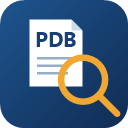

# PDB Finder

开源仓库 / Open-source repository：[Francis0927/PDB-Finder](https://github.com/Francis0927/PDB-Finder)

**为 Windows C++ 崩溃 dump 自动匹配并加载主程序符号。**

**Find and load matching main-executable symbols for Windows C++ crash dumps.**

## 中文

### 项目介绍

PDB Finder 是一个 Visual Studio 2022 扩展，用于自动准备 Windows C++ 崩溃 dump 所需的主程序调试符号，适用于使用原生 Windows PDB 符号的应用和项目。打开 `.dmp` 后，它读取主程序的 PDB GUID+Age，依次检查本地已有符号、本地索引和用户配置的构建归档，找到对应构建的 PDB。需要复制时，它会按 dump 预期的文件名准备本地副本，并在调试进入中断、且符号就绪时尝试自动加载。

### 解决的问题

- **构建归档多，人工定位慢。** 按 dump 内部的构建标识匹配，不依赖猜测构建日期、目录名或版本号。
- **PDB 名称不同导致查找失败。** 归档中的 PDB 即使改名，只要 GUID+Age 一致仍可匹配；本地副本使用 dump 预期的名称。
- **重复调试仍在访问共享目录。** 本地符号命中后直接使用；索引命中后只校验对应候选，避免重新枚举整个归档。
- **找到 PDB 后还要手动复制和加载。** 自动准备本地符号副本，并在进入调试中断时调用 VS 加载符号。
- **匹配或复制耗时却缺少反馈。** 显示阶段、路径、扫描计数、百分比和耗时，并提供取消操作及带时间戳的输出日志。
- **重打包 EXE 导致二进制校验失败。** 识别时间戳/PDB 标识相同而映像大小或校验和不同的 EXE，可经用户确认创建本地修补副本。

### 查找顺序

**本地已有 PDB → 本地索引 → 共享目录扫描。** 每一步有效命中后，跳过后续查找。

1. **本地已有 PDB：** 校验 VS 符号缓存、扩展备用缓存及本地 dump 同目录中的预期名称 PDB。只检查这些已知位置，不遍历整台电脑；UNC 和映射网络盘不属于此阶段的本地位置。本地命中无需共享根目录配置。
2. **本地索引：** 按 GUID+Age 筛选当前共享根目录内的候选，并重新读取候选 PDB 的标识、校验对应 EXE。索引保存的是路径和标识，候选文件可能仍在共享目录，因此这一阶段仍可能产生网络访问。
3. **共享目录扫描：** 索引没有有效候选时完整枚举归档，重新读取 PDB 身份并更新索引。混合布局及构建内的子目录均会覆盖；未命中后直接提供手动选择，不重复全量扫描。手动选择同样要求 GUID+Age 一致。索引读取或保存失败会记录原因，但不阻断匹配。

### 安装与配置

1. 安装 `PdbFinder.Vsix/bin/Release/net472/PdbFinder.Vsix.vsix`，完成后重启 Visual Studio 2022。源码构建和命令行安装见 [BUILD.md](BUILD.md)。
2. 打开 **工具 → 选项 → PDB Finder → General**。
3. 在 **共享根目录（每个一行）** 中用 **添加** 填入实际符号归档位置，或用 **浏览…** 选择目录。每行一个根目录，可以配置多个。优先选择包含所需构建的归档目录，缩小扫描范围；目录布局的自动识别和递归扫描规则见 [ARCHITECTURE.md](ARCHITECTURE.md)。
4. 保持 **打开 .dmp 时自动匹配** 勾选。取消勾选后，可通过 **工具 → PDB Finder: Match Current Dump** 手动匹配当前 dump。
5. 用 **测试连接** 检查共享目录。需要预先构建索引或刷新已有归档记录时，使用 **重建索引**；首次使用不要求提前手动建索引。检查完设置后点击 **确定** 保存。
6. 可在 **工具 → 选项 → 调试 → 符号** 选择本机符号缓存目录。扩展使用 VS 配置的本机缓存目录；未配置、或配置到 UNC/映射网络盘时，使用当前用户的扩展备用缓存。首次准备大型 PDB 时，需要相应的本地磁盘空间。

### 使用与确认结果

打开 `.dmp` 后，进度窗口会显示读取 dump、检查本地符号、查询索引、收集目录和扫描匹配等阶段。开始本机调试后，符号就绪时会尝试加载；若复制尚未完成，完成后会在调试中断状态下重试。

需要复制 PDB 时，始终弹出置顶的复制进度窗口，显示源文件、目标路径、已复制/总大小、百分比和耗时。传输完成后继续校验，成功时短暂显示就绪结果后自动关闭；取消和失败结果保留在窗口中供查看。点击 **取消** 或关闭正在复制的窗口会停止本次复制，不会因切回 dump 自动重启；需要重试时使用 **PDB Finder: Match Current Dump**。

在 **输出 → 显示输出来源：PDB Finder** 查看匹配来源、复制情况和加载结果。**“符号已就绪”表示文件已准备好；“VS 已加载符号”才表示调试器确认加载。** 也可在调试的 **模块（Modules）** 窗口确认主程序的符号状态。

扫描百分比按已完成目录计算，复制进度按字节计算。点击 **取消** 或关闭匹配/索引/复制窗口会停止相应任务；已有的同步网络请求需要返回后才能结束。取消未完成的索引任务会保留已发布的索引。某个共享根目录不可访问时会记录原因，并继续处理其他根目录。

### 支持范围

当前自动匹配目标是 Windows dump 中的主 EXE 模块，支持带主程序 RSDS PDB 标识的 minidump 和完整内存 dump。其他 DLL 模块的符号仍由 VS 自身的配置处理。普通 minidump 的调试可能还需要匹配的 EXE；完整内存 dump 会跳过 EXE 修补提示。归档中的原始 EXE/PDB 不会被重命名或修改。

## English

### Project overview

PDB Finder is a Visual Studio 2022 extension that prepares main-executable debugging symbols for Windows C++ crash dumps. It supports applications and projects that use native Windows PDB symbols. When a `.dmp` opens, it reads the main executable's PDB GUID and Age, then checks existing local symbols, a local index, and user-configured build archives in that order. If copying is required, it prepares a local PDB under the filename expected by the dump. It attempts to load the symbols when they are ready and the debugger is in break mode.

### Problems it solves

- **Finding the right build among many archives.** It matches the build identity recorded in the dump instead of guessing from dates, folder names, or version labels.
- **PDB filename mismatches.** Renamed archive PDBs can still match by GUID and Age; the local copy uses the name expected by the dump.
- **Repeated archive scans.** A valid local PDB skips index and archive searches. A valid index hit checks only the matching candidates instead of enumerating the whole archive.
- **Manual symbol copying and loading.** It prepares local symbols and asks VS to load them when the debugger enters break mode.
- **Long operations with little feedback.** Progress windows show phases, paths, scan counts, percentages, and elapsed time, with cancellation and timestamped output logs.
- **Binary mismatches after EXE repackaging.** It detects EXEs with matching timestamps/PDB identities but different image sizes or checksums, and can create a patched local copy after user confirmation.

### Search order

**Existing local PDB → local index → shared-directory scan.** A valid match skips the remaining searches.

1. **Existing local PDB:** Checks the VS symbol cache, the extension's fallback cache, and the expected PDB filename beside a local dump. It probes these known locations rather than searching the entire computer. UNC locations and mapped network drives are excluded from this local phase. A local hit does not require a shared root to be configured.
2. **Local index:** Filters candidates by GUID and Age within the currently configured roots, then revalidates the PDB identity and corresponding EXE. The index stores paths and identities, not PDB contents, so validating a candidate may still access a network share.
3. **Shared-directory scan:** Walks the entire archive, including mixed layouts and nested build directories, and reads current PDB identities before updating the index. A miss offers manual PDB selection without repeating a full scan. Index read/write failures are logged without blocking matching. Manually selected PDBs must also match the GUID and Age.

### Installation and configuration

The settings control and progress messages currently use Chinese labels; the labels below identify the corresponding controls.

1. Install `PdbFinder.Vsix/bin/Release/net472/PdbFinder.Vsix.vsix`, then restart Visual Studio 2022. See [BUILD.md](BUILD.md) for source builds and command-line installation.
2. Open **Tools → Options → PDB Finder → General**.
3. Under **Shared root directories** (`共享根目录（每个一行）`), use **Add** (`添加`) to enter your actual symbol archive location, or **Browse…** (`浏览…`) to select it. Add one root per line; multiple roots are supported. Choose archive directories containing the relevant builds to keep the scan focused. See [ARCHITECTURE.md](ARCHITECTURE.md) for layout detection and recursive scanning rules.
4. Keep **Match automatically when a .dmp opens** (`打开 .dmp 时自动匹配`) checked. If disabled, use **Tools → PDB Finder: Match Current Dump** to match the active dump manually.
5. Use **Test Connection** (`测试连接`) to check the roots. Use **Rebuild Index** (`重建索引`) to prebuild the index or refresh archive records; a manual rebuild is not required before first use. Click **OK** to save the settings.
6. Optionally choose a local cache under **Tools → Options → Debugging → Symbols**. The extension uses a local VS cache setting, falling back to its per-user cache when unset or configured on a UNC path or mapped network drive. Large PDBs need sufficient local disk space for their first copy.

### Usage and result verification

Open a `.dmp` to see progress for dump parsing, local-symbol checks, index lookup, directory enumeration, and matching. Start native debugging; the extension attempts to load symbols when they are ready. If copying is still in progress, it retries after completion while the debugger is in break mode.

Whenever a PDB needs copying, a topmost progress window opens with the source, destination, copied/total size, percentage, and elapsed time. Validation follows the transfer. Success briefly shows a ready state before the window closes automatically; cancellation and error results remain visible. **Cancel** or closing the window during copying stops that copy. Returning to the dump does not restart it automatically; use **PDB Finder: Match Current Dump** to retry.

Select **PDB Finder** in the **Output** window to inspect the match source, copying, and loading results. **“符号已就绪” (symbols ready) means the files are prepared; “VS 已加载符号” (VS loaded symbols) confirms debugger loading.** You can also check the main executable's symbol status in the debugger's **Modules** window.

Scan percentages measure completed directories; copying progress measures bytes. Cancelling or closing the matching/index/copy window stops the corresponding task, after any current synchronous network request returns. Cancelling an unfinished index task preserves the published index. An inaccessible root is reported, and the remaining roots are processed.

### Scope

Automatic matching currently targets the main EXE module in a Windows dump. Minidumps and full-memory dumps with a main-executable RSDS PDB identity are supported. Symbols for other DLL modules remain governed by VS's own configuration. A regular minidump may also require a matching EXE; full-memory dumps skip the EXE patch prompt. Original archive EXEs and PDBs are neither renamed nor modified.

## Documentation / 文档

- [BUILD.md](BUILD.md) — 构建、安装、卸载和回归验证 / Build, installation, uninstallation, and regression checks.
- [ARCHITECTURE.md](ARCHITECTURE.md) — 当前实现、查找顺序、缓存和失败处理 / Current implementation, search order, caches, and failure handling.
- [DEVELOPMENT_PLAN.md](DEVELOPMENT_PLAN.md) — 开发计划与按日期记录的验证结果 / Development plan and dated verification records.
